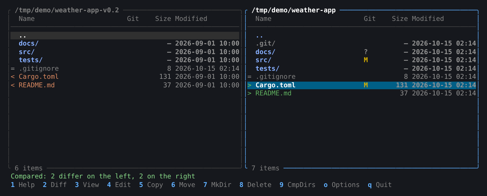
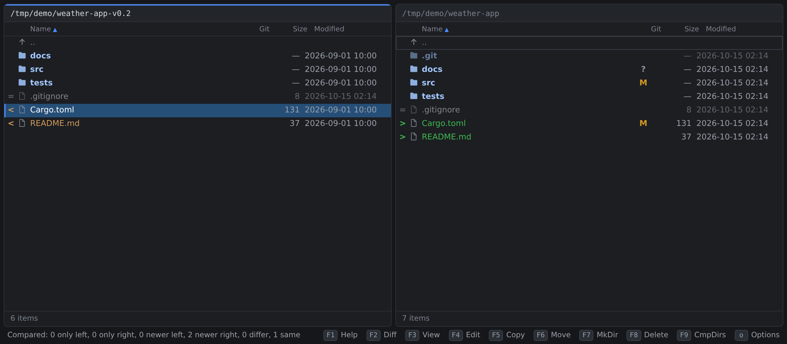
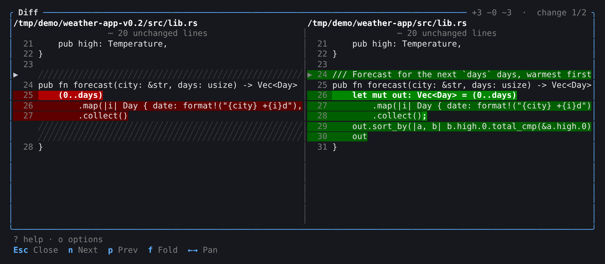
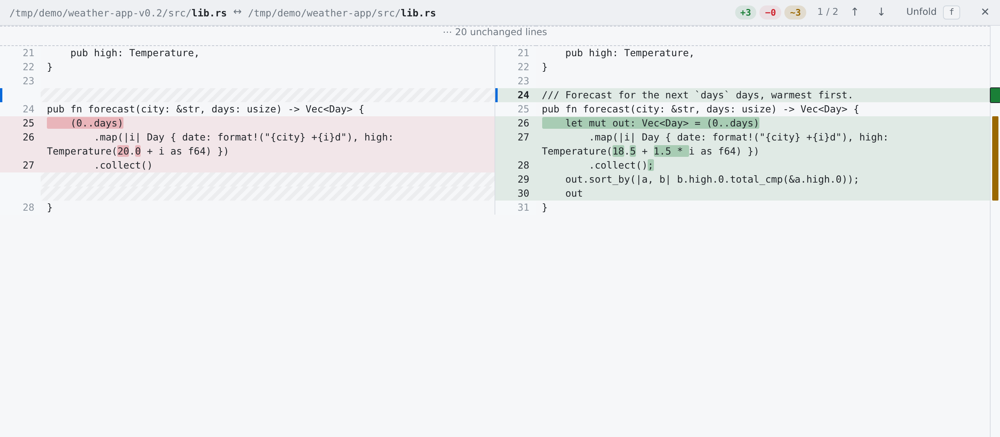

# rcommander

A fast, keyboard-driven, Total Commander-style dual-pane file manager written in Rust, with a **terminal UI** and a **browser UI** (Rust compiled to WebAssembly) that share one core. It is made to work alongside coding agents: Claude Code can point you at files and diffs, and panels refresh live as files change.

Runs on **Linux and macOS** (both built and tested in CI).

| Terminal (`rcmd`) | Browser (`rcmd web`) |
|---|---|
|  |  |
|  |  |

## Features

- **Two panels, keyboard first**: Total Commander keys (F3 view, F5 copy, F6 move, F7 mkdir, F8 delete, Tab, Insert…), with digits as F-key aliases for Mac keyboards.
- **Side-by-side diff** (F2) with inline highlights, folded unchanged regions and change navigation; Shift+F2 diffs against git `HEAD`.
- **Git aware**: a status column (modified, added, untracked, …) using git without taking its index lock.
- **Live refresh**: folders re-read themselves when files change, and changed rows light up.
- **Safe file operations**: asks before overwriting (replace, replace older, keep existing), atomic replacement so a failed or cancelled copy never damages existing files, Trash instead of delete; both UIs show byte progress and cancel with Esc.
- **Find files** (Alt+F7 or Shift+F): name masks and text inside files, then jump to a hit or view it at the matching line.
- **Quick View** (Ctrl+Q or Shift+Q): the other panel previews the file under the cursor (or summarizes a folder) as you move.
- **Multi-rename** (Shift+F6): rename many files at once with a mask (`[N]` name, `[E]` extension, `[C]` counter, `[P]` folder), search and replace, and case, previewing every new name first; swaps and chains are safe.
- **Directory compare** (F9), quick filter, selection masks, history (Alt+←/→), hotlist (Ctrl+D), zoxide jumps (terminal).
- **Configurable columns**: permissions, owner, group, created, extension, git; hidden files; your editor for F4.
- **Claude's changes**: every file Claude edits is logged with its original; press `c` to list them and F2 to review each one as a diff.
- **Remote control** with `rcmd ctl`, and a **Claude Code plugin** so Claude can show you files, lines and diffs, or follow its own edits.
- **Two front ends, one core**: panel logic, diff engine and settings are shared, so both UIs behave the same.

## Quick start

**Requirements:** Rust 1.85 or newer (`rustup`), a C linker (Xcode Command Line Tools on macOS, `build-essential` or equivalent on Linux), and `git` on your PATH for the Git column. [zoxide](https://github.com/ajeetdsouza/zoxide) is optional (`z` in the terminal UI); [trunk](https://trunk-rs.github.io/trunk/) is needed only for the browser UI.

Terminal UI only:

```sh
git clone https://github.com/mazzucci/rcommander && cd rcommander
cargo install --path crates/rcmd          # then run: rcmd
```

Terminal **and** browser UI: build the front end first, so it is embedded in the binary.

```sh
rustup target add wasm32-unknown-unknown
cargo install trunk --locked
(cd crates/rc-web && trunk build --release)
cargo install --path crates/rcmd --force  # then: rcmd, or rcmd web
```

If `rcmd web` says it was *compiled without the web front end*, run the second block (with `--force`).

Settings live in `~/.config/rcommander/settings.toml` on Linux and `~/Library/Application Support/rcommander/settings.toml` on macOS; press `o` in either UI to change them, or point `RCOMMANDER_CONFIG` at another file.

## Layout

| Crate | Purpose |
|-------|---------|
| `crates/rc-core` | Platform-independent model: locations, panel state (cursor, selection, sort, filter), side-by-side diff engine, directory compare, HTTP API types. Compiles to native and `wasm32`. |
| `crates/rc-vfs`  | Native back end: local filesystem listing, reading, copy/move/delete (to Trash)/mkdir. |
| `crates/rcmd`    | The `rcmd` binary: terminal UI, and `rcmd web`, a local server for the browser UI. |
| `crates/rc-web`  | Browser UI (Leptos), compiled to WebAssembly with [trunk](https://trunk-rs.github.io/trunk/). |

## Usage

```sh
rcmd [LEFT_DIR] [RIGHT_DIR]                # terminal UI; defaults: current directory, home
rcmd web [LEFT_DIR] [RIGHT_DIR]            # browser UI, opens your default browser
rcmd web --browser "Google Chrome"         # pick a browser; --no-open just prints the URL; --port N
```

The browser UI's server listens on 127.0.0.1 only, and every API call needs the random token from the URL it opens.

Both UIs share the key bindings below; the few differences are marked. `F1` or `?` shows them in the app.

| Key | Action |
|-----|--------|
| ↑ ↓ PgUp PgDn Home End | move cursor |
| Enter / → | open directory, view file |
| Backspace / ← | parent directory |
| Alt+← Alt+→, `[` `]` | back / forward in the panel's history |
| Tab | switch panel |
| Space / Insert | select / deselect |
| `+` `-` `*` | select by mask, deselect by mask, invert selection |
| Esc | clear filter, then selection, then cancel a running copy, move or delete |
| `/` Ctrl+F | quick filter |
| `.` | show / hide hidden files |
| `g` Ctrl+L | go to path |
| Ctrl+D | hotlist: `a` add current folder, `d` remove, Enter or `1`..`9` go |
| `c` | Claude's changes: files an agent edited — F2 diff against the original, F3 view, F8 forget (the files stay) |
| `z` | jump with zoxide (terminal only) |
| `o` | options: columns, hidden files, editor |
| Ctrl+S, Ctrl+F3..F6 | cycle sort / sort by name, extension, date, size |
| Ctrl+R, Ctrl+U | refresh / swap panels |
| F1 / `?` | key help |
| F2 | diff the files under both cursors (or two selected); against git HEAD if the other panel has no such file — `n`/`p` next/previous change, `f` fold |
| Shift+F2 | diff the file against git HEAD |
| F3 / F4 | view / edit (terminal: the editor from options, else `$VISUAL`/`$EDITOR`; browser: the GUI editor from options, else the default application) |
| F5 / F6 | copy / move or rename; asks before overwriting: `o` replace existing, `u` replace older, `s` keep existing (folders are merged); shows byte progress, Esc cancels |
| F7 / F8, Delete | new directory / delete to Trash (Shift+F8: permanent) |
| F9 | compare directories (toggle) |
| Shift+F6, `M` (browser also Ctrl+M) | multi-rename the selection: mask, search/replace, case, counter, with a preview |
| Ctrl+Q, Shift+Q | quick view: the other panel previews the file (or folder) under the cursor |
| Alt+F7, Shift+F | find files: name mask (`*.rs;*.toml`, a plain word matches inside names) and text inside (case-sensitive only with capitals); Enter go to, F3 view |
| `1`..`9` | same as F1..F9, so Mac laptops don't need the fn key |
| `q` F10 Ctrl+C | quit (terminal only) |

Panels follow changes on disk: a directory that changes is re-read and the new or changed entries light up briefly. `rcmd ctl` commands (below) reach the browser UI too.

## Remote control and Claude Code

A running `rcmd` (terminal or web) can be driven from scripts:

```sh
rcmd ctl goto src/main.rs --side right   # show a file in its directory
rcmd ctl diff old.txt new.txt            # open the side-by-side diff
rcmd ctl view README.md --line 42       # open the viewer at a highlighted line
printf '%s' "$OLD" | rcmd ctl track FILE  # log FILE's original for "Claude's changes"
rcmd ctl changes [--clear]               # show (or clear) Claude's changes
rcmd ctl select '*.rs'
rcmd ctl message "build finished"
```

Each instance listens on a Unix socket only your user can open (`$XDG_RUNTIME_DIR/rcommander/`, or a private per-user folder in the temp dir; rcmd refuses folders it doesn't own). Commands are refused while a dialog is open, never move your focus, and `rcmd ctl diff - FILE` reads the "before" side from stdin.

The **rcommander Claude Code plugin** (`integrations/claude-code`) builds on this. It adds:

- a `/rc` command (`/rc goto <path>`, `/rc diff <a> <b>`, …);
- a tool Claude can call to show you a file, a line, a directory or a diff (it only moves your file manager, so it runs without a permission prompt);
- **Claude's changes**: before each edit it records the file's original (only the first time), so `c` in rcommander lists everything Claude touched and F2 shows each change in full (option *Record Claude's changes*);
  originals are kept in your private runtime folder (`$XDG_RUNTIME_DIR/rcommander/changes`, or a per-user temp folder on macOS) until `rcmd ctl changes --clear` or logout, across all projects; files over 8 MiB are not recorded;
- optionally following Claude's edits: after it edits a file, rcommander shows it in the other panel (`goto`, the default) or opens a diff of the change (`diff`).

Install it from a Claude Code terminal session:

```
/plugin install rcommander --marketplace mazzucci/rcommander
```

or from a shell: `claude plugin install rcommander --marketplace mazzucci/rcommander`. Change *Follow Claude's edits* and the `rcmd` path in the plugin's settings.

## Development

```sh
cargo test          # unit tests
cargo clippy --all-targets
cargo fmt --all
```

## Process

Every change goes through a feature branch → code review → pull request → CI (fmt, clippy and tests on Linux and macOS; the wasm32 front end built with trunk and served by a release binary) → merge.

## License

[MIT](LICENSE)
